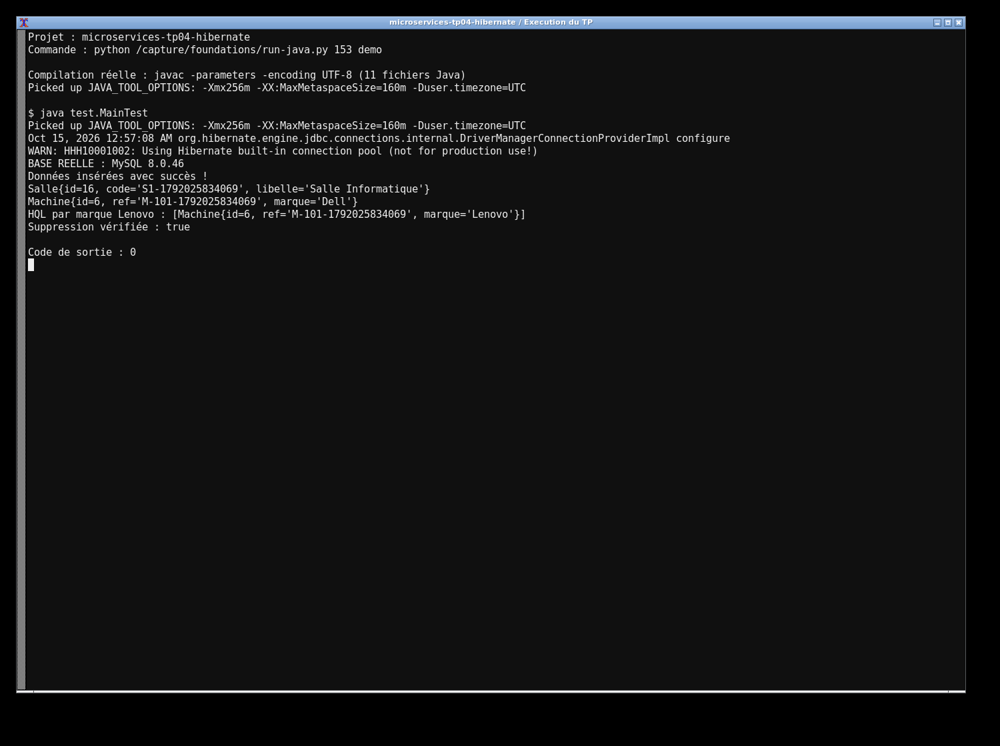
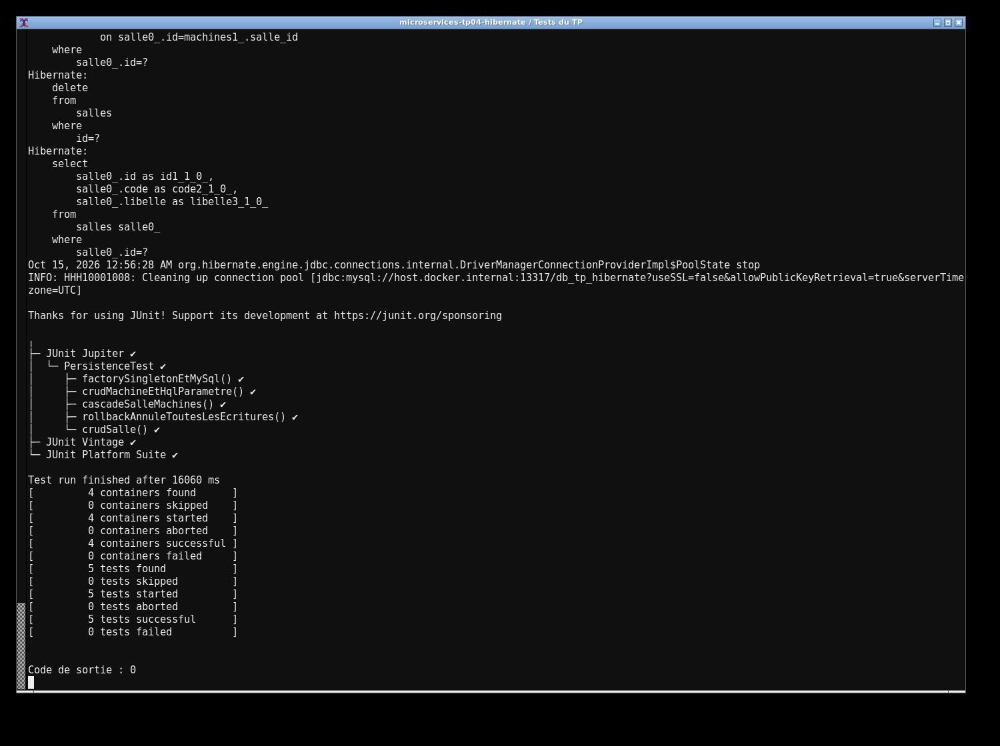

# TP4 — Hibernate et MySQL

J'ai réalisé la gestion des salles et des machines avec Hibernate 5.6.15 et MySQL 8. Les entités `Salle` et `Machine` ont une relation bidirectionnelle. Chaque entité dispose d'un DAO et d'un service qui implémentent `IDao<T>`. `HibernateUtil` partage une seule `SessionFactory`.

J'utilise Java 17 et Maven. Pour lancer le projet :

```sh
docker compose up -d --wait
mvn clean test
mvn exec:java
```

La base `db_tp_hibernate` écoute sur 13317, avec `root` et le mot de passe local `labroot`. `DB_URL`, `DB_USER` et `DB_PASSWORD` permettent d'utiliser une autre instance. Les tests utilisent réellement MySQL. Ils couvrent le CRUD des deux entités, la cascade, la requête HQL `findByMarque` et un doublon de code qui annule toutes les écritures de la transaction. La démonstration insère une salle et une machine, les consulte, modifie la marque puis supprime ses données.

Les captures montrent l'exécution réelle du projet et des tests sur ma machine.



